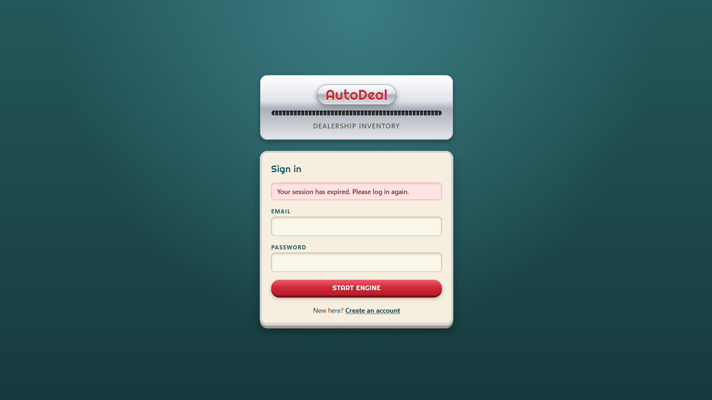
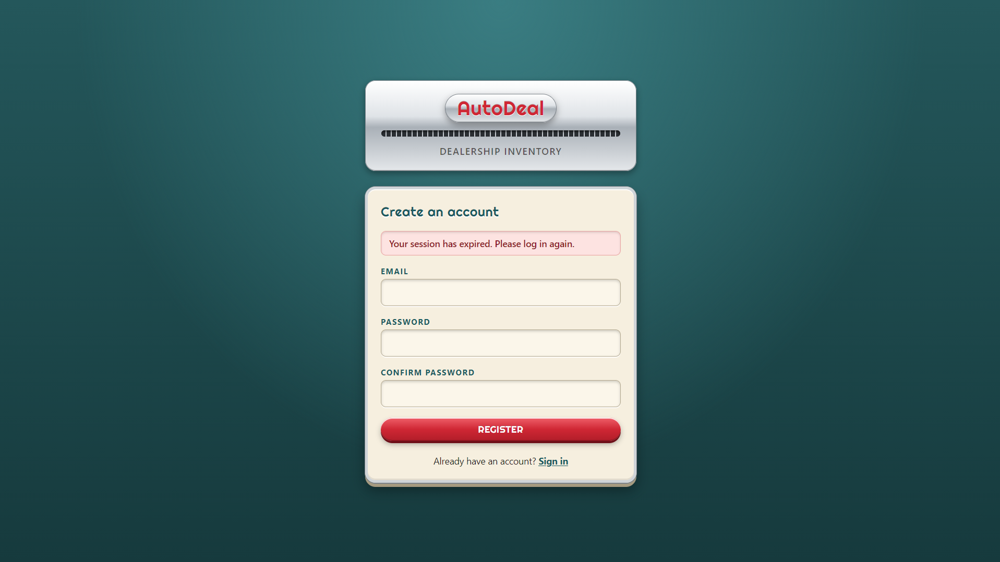
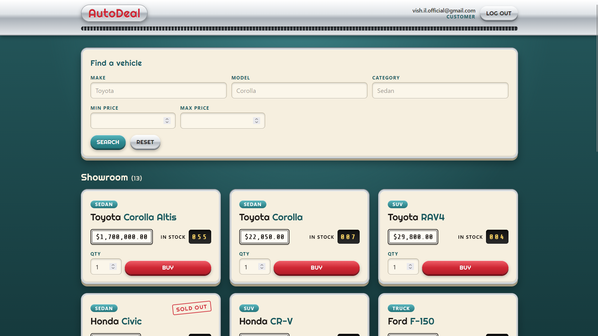
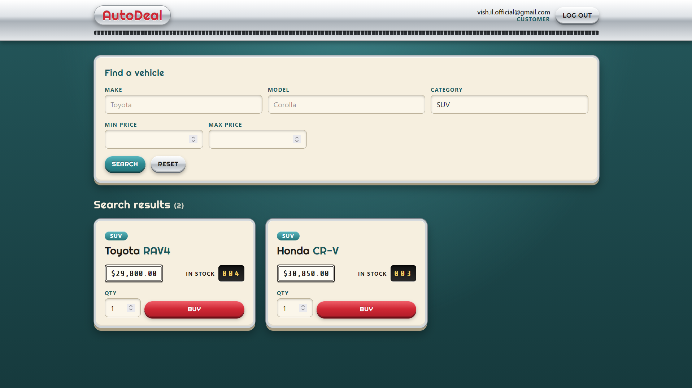
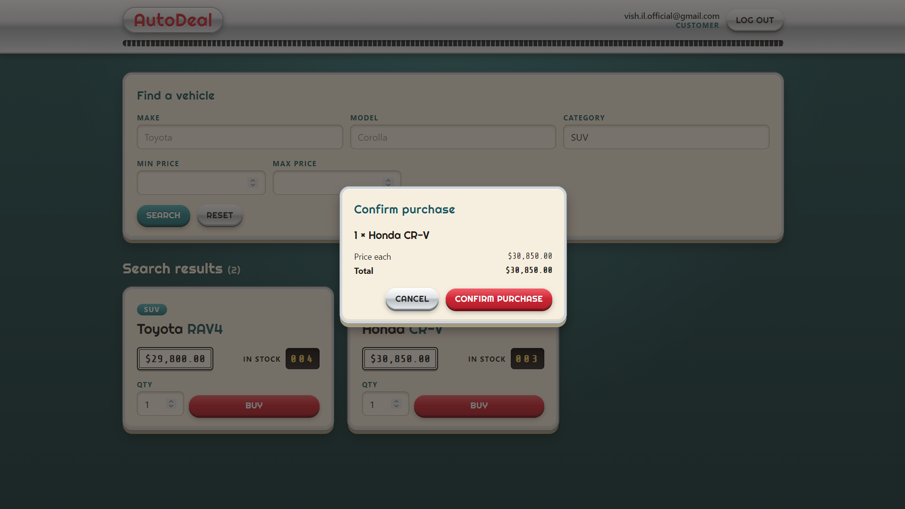
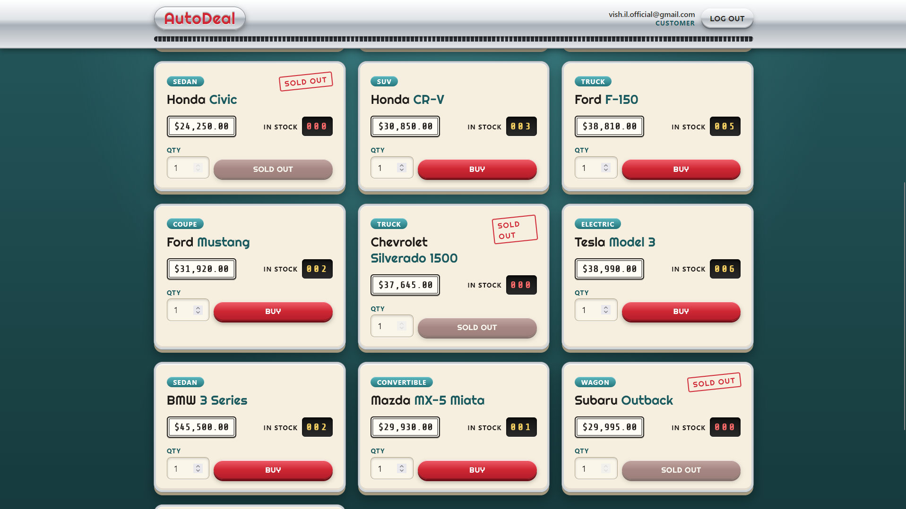
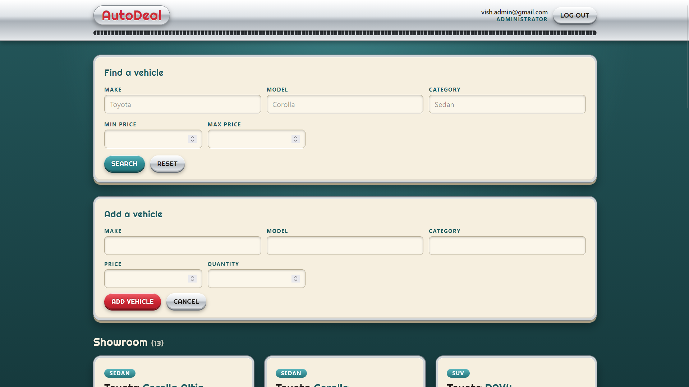

# AutoDeal: Car Dealership Inventory

A full-stack car dealership inventory system built with test-driven development (red, green, refactor).
Customers can register, log in, browse, search and buy vehicles. Administrators can also add, edit, delete and restock them.

- **Backend:** FastAPI, PostgreSQL, SQLAlchemy and JWT authentication
- **Frontend:** React, Vite and Tailwind CSS, with a retro "chrome and dashboard" look

Latest test results: [TEST_REPORT.md](TEST_REPORT.md). AI chat logs: [PROMPTS.md](PROMPTS.md).

## Features

- Register and log in with email and password. Passwords are hashed with bcrypt, and logins return a JWT bearer token that's valid for 30 minutes.
- Every vehicle route requires a valid token. A missing, invalid or expired token gets `401`.
- Vehicles have a make, model, category, price and quantity in stock.
- List vehicles, and search by make, model or category (partial, ignores case) and by min/max price (inclusive).
- Purchase a quantity of a vehicle. Stock can never go negative:
  - the row is locked while the purchase is processed, and the database has a `CHECK (quantity >= 0)` constraint
  - buying more than is in stock returns `409 Insufficient stock`.
- Admin-only delete and restock. Non-admins get `403`.
- The frontend has:
  - login and register screens
  - the vehicle grid with search filters
  - a buy confirmation dialog
  - a disabled **Sold out** button when stock is 0
  - admin-only add, edit, delete and restock controls
  - loading states, and error messages for validation errors, 401, 403 and insufficient stock.
- An optional seed script adds 12 sample cars, three of them sold out. It's safe to run more than once.

## Tech stack

| Area | Tools (versions used during development) |
|---|---|
| Backend | Python 3.14, FastAPI 0.162, SQLAlchemy 2.1, psycopg 3, Pydantic 2, PyJWT, bcrypt, Uvicorn |
| Database | PostgreSQL 18 |
| Backend tests | pytest 9 with FastAPI `TestClient` (via `httpx2`), against a real PostgreSQL test database |
| Frontend | React 19, Vite 8, Tailwind CSS 4 |
| Frontend tests | Vitest 5, React Testing Library, jsdom |

## Project structure

```
backend/
  app/
    main.py            FastAPI app: startup (creates tables), CORS, routers, /health
    database.py        engine, sessions, init_db()
    models.py          Vehicle and User tables
    schemas.py         request/response validation (Pydantic)
    auth.py            password hashing, JWT, current-user and admin checks
    routers/auth.py    /api/auth/register, /login, /me
    routers/vehicles.py  /api/vehicles CRUD, search, purchase, restock
  seed_vehicles.py     optional sample data
  tests/               pytest suite (conftest.py holds the database and auth fixtures)
frontend/
  src/api/             all backend calls (client.js adds the token and handles errors)
  src/context/         AuthContext: logged-in user and token
  src/components/      screens and UI pieces (AuthPage, Dashboard, VehicleCard, ...)
  src/index.css        Tailwind plus the retro theme
pyproject.toml         pytest configuration
requirements.txt       backend dependencies
```

## API

| Method | Path | Access |
|---|---|---|
| GET | `/health` | Public |
| POST | `/api/auth/register` | Public |
| POST | `/api/auth/login` | Public |
| GET | `/api/auth/me` | Logged in |
| POST | `/api/vehicles` | Logged in |
| GET | `/api/vehicles` | Logged in |
| GET | `/api/vehicles/search?make=&model=&category=&min_price=&max_price=` | Logged in |
| PUT | `/api/vehicles/{id}` | Logged in |
| DELETE | `/api/vehicles/{id}` | Admin |
| POST | `/api/vehicles/{id}/purchase` (body `{"quantity": n}`) | Logged in |
| POST | `/api/vehicles/{id}/restock` (body `{"quantity": n}`) | Admin |

When the backend is running, interactive API docs are at http://localhost:8000/docs.

## Prerequisites

- Python 3.14 (developed and tested with 3.14.2)
- PostgreSQL running on `localhost:5432` (developed with 18.6)
- Node.js and npm (developed with Node 24.16 and npm 11.13)

> The commands below were run and checked on Windows, in Git Bash from the project root. On macOS or Linux, use `.venv/bin/python` instead of `.venv/Scripts/python`.

## Database setup

Create the development and test databases:

```bash
psql -h localhost -U postgres -c "CREATE DATABASE car_inventory"
psql -h localhost -U postgres -c "CREATE DATABASE car_inventory_test"
```

The backend creates its tables (`users`, `vehicles`) automatically on startup. It only adds missing tables and never drops or resets existing data. There are no migrations, so changing an existing table's structure later needs a manual `ALTER TABLE`.

The default connection strings use the `postgres` user **with no password**:

- Development: `postgresql+psycopg://postgres@localhost:5432/car_inventory`
- Tests: `postgresql+psycopg://postgres@localhost:5432/car_inventory_test`

If your PostgreSQL user needs a password, set environment variables instead:

| Variable | Used by | Default |
|---|---|---|
| `DATABASE_URL` | backend, seed script | `postgresql+psycopg://postgres@localhost:5432/car_inventory` |
| `TEST_DATABASE_URL` | pytest | `postgresql+psycopg://postgres@localhost:5432/car_inventory_test` |
| `SECRET_KEY` | JWT signing | a development-only value; **set this for any real deployment** |
| `CORS_ORIGINS` | allowed frontend origins (comma-separated) | `http://localhost:5173` |
| `VITE_API_URL` | frontend (`frontend/.env`, see `.env.example`) | `http://localhost:8000` |

## Backend: install and run

```bash
python -m venv .venv
.venv/Scripts/python -m pip install -r requirements.txt

cd backend
../.venv/Scripts/python -m uvicorn app.main:app --reload
```

The API runs at http://localhost:8000 (check with http://localhost:8000/health).

Optional sample data, run from `backend/`. It's safe to rerun: existing cars are skipped and never changed.

```bash
../.venv/Scripts/python seed_vehicles.py
# Inserted 12 sample vehicles (0 already present).
```

## Frontend: install and run

In a second terminal:

```bash
cd frontend
npm install
npm run dev
```

Open http://localhost:5173. The backend only allows this origin by default.

To build for production: `npm run build`. The output goes to `frontend/dist/`.

## Creating an admin account

Registration always creates a regular user, so nobody can make themselves an admin through the app. To create an admin:

1. Register normally in the app (or with `POST /api/auth/register`).
2. Promote the account in PostgreSQL:

   ```bash
   psql -h localhost -U postgres -d car_inventory -c "UPDATE users SET is_admin = true WHERE email = 'you@example.com';"
   ```

3. Reload the page. The admin role is checked on every request, so you don't need to log in again.

## Running the tests

Backend, from the project root. This needs the `car_inventory_test` database. Each test runs in a transaction that is rolled back, and the tables are dropped at the end of the run.

```bash
.venv/Scripts/python -m pytest
```

Frontend, from `frontend/`:

```bash
npm test
npm run build
```

Latest results: **120 backend tests passed, 5 frontend tests passed, production build succeeded.** See [TEST_REPORT.md](TEST_REPORT.md) for the full output.

## Screenshots

> **TODO (author):** take these screenshots from the running app and save them with exactly these file names. Until then, the images below won't display.

| Screen | How to get there | Save as |
|---|---|---|
| Login | Open http://localhost:5173 while logged out | `docs/screenshots/01-login.png` |
| Register | Click "Create an account" | `docs/screenshots/02-register.png` |
| Customer dashboard | Log in as a regular user after running the seed script | `docs/screenshots/03-dashboard-customer.png` |
| Search results | Search for something, e.g. Category `SUV` | `docs/screenshots/04-search.png` |
| Buy confirmation | Click **Buy** on a car that's in stock | `docs/screenshots/05-buy-confirm.png` |
| Sold-out card | Any car with stock 0 (e.g. Honda Civic from the seed data) | `docs/screenshots/06-sold-out.png` |
| Admin dashboard | Log in as an admin, open "New vehicle" | `docs/screenshots/07-dashboard-admin.png` |









## Known limitations

- The API allows any logged-in user to create and update vehicles, as the original spec required. The frontend only shows those forms to admins.
- There are no database migrations. Tables are created with SQLAlchemy `create_all`, which doesn't change tables that already exist.
- There's no admin management in the app. Admins are promoted with SQL, as described above.
- The JWT is stored in the browser's `localStorage`.
- Emails are case-sensitive (`User@x.com` and `user@x.com` are different accounts).
- A very large restock can exceed PostgreSQL's integer limit and return a `500` error.
- Frontend tests only cover the vehicle card's buy flow.

## My AI Usage

**Tool:** Claude Code (Anthropic's coding assistant, Claude Opus model) in the VS Code extension. Raw chat logs are in [PROMPTS.md](PROMPTS.md).

**How it was used:**

- I used Claude as a pair programmer while directing the work myself. I wrote the prompt for each step: the endpoint requirements, the order of TDD cycles, and what should be tested.
- For each cycle, Claude wrote the failing tests, ran them to show they were red, wrote the code to make them pass, then ran the targeted tests and the full suite.
- For the bigger design choices, Claude asked me and I chose:
  - sync SQLAlchemy with psycopg 3
  - a separate test database with a rollback after each test
  - `create_all` instead of Alembic.
- Claude made smaller choices itself (status codes such as `409`, field names, validation limits) and listed them for me to review.
- Claude was not allowed to run Git. I reviewed the changes, ran the tests and made the commits myself. Claude gave me the `git add` and commit commands, with a `Co-authored-by: Claude` trailer.
- Claude also wrote the React frontend, the seed script and the first draft of this documentation, including this section's factual parts.

I relied heavily on Claude Code throughout this project, but my level of involvement varied across parts of the application.

For the backend, I was more familiar with the technologies and concepts involved, so I was able to make many of the design decisions, choose the implementation approach, and guide the development process. I used Claude to help implement features, write tests, debug issues, and review possible approaches, while making decisions about the overall architecture and functionality myself.

Testing was one of my weaker areas going into this project, so I relied on Claude considerably for writing test cases, structuring the test suite, and understanding the TDD workflow. Similarly, I had very little prior experience with frontend development, so Claude handled most of the React and Tailwind implementation. I contributed by providing design preferences, making decisions about the user experience, and guiding the frontend towards the intended result.

Overall, AI allowed me to build a more complete application while working with technologies and practices I was less familiar with. At the same time, this experience showed me where I need to improve, particularly in writing and understanding tests independently and gaining hands-on frontend experience. I see the project not just as a finished application, but also as an opportunity to identify gaps in my knowledge and areas I want to develop further.